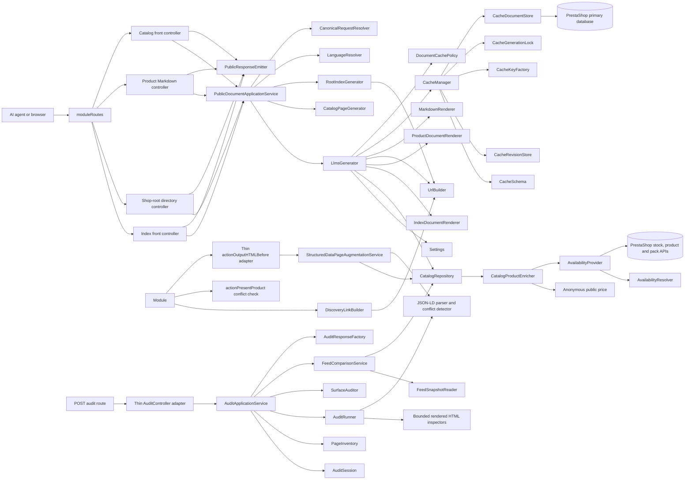
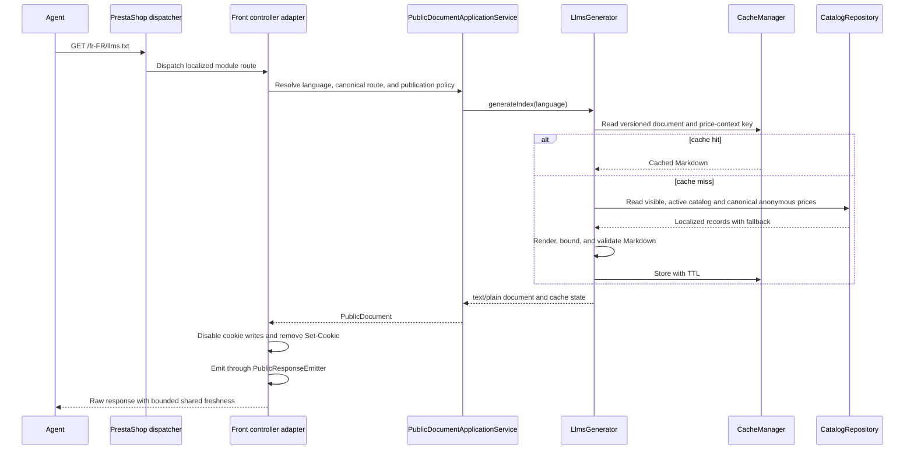

# Architecture

## Components

The four front controllers are PrestaShop lifecycle adapters: they disable
cookie writes, remove `Set-Cookie`, delegate request decisions to
`PublicDocumentApplicationService`, and emit the returned `PublicDocument`
through `PublicResponseEmitter`. The application service accepts GET and HEAD,
resolves active shop languages from the raw request path, applies publication
and canonical-route policy, coordinates index/product/catalog/root document
generation and catalog-page caching, and maps failures to the established
status and header shapes. `LanguageResolver` rejects invalid, inactive,
unassigned, and ambiguous aliases. `UrlBuilder` owns the full-locale route and
`LinkHeaderBuilder` emits deterministic representation and language relations.
`RootIndexGenerator` publishes a cached language directory scoped by shop,
base URL, default language, active-language fingerprint, settings, and routing
revision. `DiscoveryLinkBuilder` supplies the same ordered relationship list to
the theme HTML hook and the independent HTTP Link hook. Homepage and category
pages receive only `describedby`; eligible products receive Markdown
`alternate` followed by `describedby`. The root directory contains links only,
not a duplicate catalog. `TranslationResolver` applies requested,
shop-default, then English wording fallback. `PublicPriceContextFactory`,
`AnonymousContextRunner`, and `PublicPriceCalculator` isolate PrestaShop price
calculation from visitor state. `CatalogRepository` owns eligibility and
localized catalog reads. `CatalogProductEnricher` adds anonymous public price
and availability facts only to full index/product reads; cursor queries remain
compact and skip those facts. `CacheManager` is the cache application facade:
`CacheSchema` owns table creation/removal, `CacheRevisionStore` reads dependency
snapshots, `CacheKeyFactory` owns compatible stable keys,
`CacheGenerationLock` coordinates origin generation, and `CacheDocumentStore`
reads and writes document rows. `InvalidationService` bumps
shop/product or global revisions without enumerating document rows.
`AvailabilityProvider` obtains product-aware sellable quantity (including
combination and pack behavior) and `AvailabilityResolver` supplies the same
stable state and Schema.org mapping used by Markdown and the storefront
presenter correction. Runtime parity remains pending the PHP/test-shop matrix.

The GEO foundation layer is isolated from publishing. `AuditController` is a
PrestaShop/Symfony adapter for authorization, POST and CSRF checks, bounded
upload validation, HTTP status and JSON responses, and report downloads.
`AuditApplicationService` coordinates execution, comparison, cancellation,
and the shop/language-scoped session lifecycle through `AuditSession`, while
`FeedComparisonService` owns feed parsing and sampled catalog reconciliation.
`AuditResponseFactory` assembles the established JSON and download report
shapes, and `AuditSummary` owns severity totals. `AuditFinding` and
`AuditReport` carry public evidence, `AuditRunner` caps each batch at five
entries and the sample at 36, and the HTML/robots/structured-data inspectors only read
their inputs. Feed uploads remain limited to 2 MiB and report/session state
expires after 15 minutes. `UrlGuard` accepts HTTPS URLs only for explicitly authorized
hosts and rejects IP literals. Organization and BreadcrumbList augmentation
remain missing-only. Product augmentation fills missing offer fields in one
canonical JSON-LD Product entity, or adds a complete Product JSON-LD node when
existing Microdata is incomplete. Conflicts, malformed JSON-LD, oversized
documents, ambiguous entities, or missing `<head>` leave the response
unchanged. The audit inspects Product JSON-LD and Microdata and reports missing
Offer fields and variant ranges. The `actionOutputHTMLBefore` method in `llmscatalog.php` is a thin
adapter to `StructuredDataPageAugmentationService`. That service checks the
page type and shop-scoped opt-ins before doing page-specific reads, assembles
public Organization, Product/Offer or Product/AggregateOffer, and BreadcrumbList
candidates, and delegates conflict checks and insertion to `StructuredDataAugmenter`. Product
offers use the canonical anonymous public price and availability; hidden or
degraded prices and noncanonical requests are not augmented. Variant ranges
are complete or omitted when the configured variant bound is exceeded.
Failures restore the original HTML, and logging is guarded so
logger failures cannot interrupt page delivery. No augmentation path fetches a
URL. Runtime hook semantics and theme conflict behavior still require
PrestaShop validation.

The catalog request path in `PublicDocumentApplicationService` serves compact
ID-cursor pages from `CatalogRepository` through `CatalogPageGenerator`. It
selects no price, stock, or descriptions, caps each fetch at 101 rows, and keys
its cache by shop, locale, document kind, cursor, and configuration identity.
The root reports eligible and featured counts and links to traversal when
complete indexes are enabled.

## Request flow

## Localization and multistore

Settings are explicitly global module configuration. Output uses the current
shop and requested active locale. Pricing uses the shop default currency, shop
address, and unidentified visitor group; customer, cart, cookie, geolocation,
and selected currency state are excluded. Merchant fields retain source
language metadata and fallback is disclosed once when emitted.

Remediation 07 code and translation dictionaries are present. Runtime and
static validation remain pending in PHP-enabled CI and a PrestaShop test shop.

## Operability and validation status

The current source includes best-effort, bounded diagnostics for public index,
product, catalog, and root generation; product eligibility lookup; cache reads,
writes, stale fallback, and generation locks; price and availability
degradation; discovery metadata; structured-data augmentation; provider hooks;
and admin feed comparison. Entries contain an operation category, shop ID,
and exception class only. They exclude rendered HTML, customer or cart data,
uploaded feed contents, exception messages, and credentials. Logger errors are
swallowed by `SafeDiagnosticLogger` so diagnostics cannot change the original
fail-open response or admin validation behavior.

These are source-level changes only. PHP syntax/runtime behavior, PrestaShop
9.0.2 compatibility, logger failure behavior, storefront responses, cache
fallbacks, and admin workflows still require validation in the supported PHP
and PrestaShop environments. No runtime validation is claimed here.

## Security and privacy

- Public routes do not require authentication.
- Product eligibility requires active status and visible catalog visibility.
- Input IDs are cast to integers and database values are queried through
  PrestaShop's query builder.
- HTML is stripped from generated text before Markdown rendering.
- No customer, order, private price, or back-office data enters the document.
- The admin form is a Symfony form, so submitted settings receive CSRF
  protection and normal back-office authorization.

## Source mapping

| Concern | Source |
| --- | --- |
| Module lifecycle and hooks | `llmscatalog/llmscatalog.php` |
| Front routes | `llmscatalog/llmscatalog.php` and `llmscatalog/controllers/front/` |
| Public route policy, document coordination, and error mapping | `llmscatalog/src/Service/PublicDocumentApplicationService.php` |
| Front response emission and conditional GET/HEAD handling | `llmscatalog/src/Service/PublicResponseEmitter.php` and `llmscatalog/src/ValueObject/PublicDocument.php` |
| Catalog eligibility and localized reads | `llmscatalog/src/Service/CatalogRepository.php` |
| Public price and availability enrichment | `llmscatalog/src/Service/CatalogProductEnricher.php` |
| Index and product generation orchestration | `llmscatalog/src/Service/LlmsGenerator.php` |
| Root index and basic/rich product rendering | `llmscatalog/src/Service/IndexDocumentRenderer.php` and `ProductDocumentRenderer.php` |
| Markdown safety | `llmscatalog/src/Service/MarkdownRenderer.php` |
| Cache facade | `llmscatalog/src/Service/CacheManager.php` |
| Cache document-row persistence | `llmscatalog/src/Service/CacheDocumentStore.php` |
| Shared document freshness and persistence policy | `llmscatalog/src/Service/DocumentCachePolicy.php` |
| Cache schema, revision reads, key construction, and generation locks | `llmscatalog/src/Service/CacheSchema.php`, `CacheRevisionStore.php`, `CacheKeyFactory.php`, and `CacheGenerationLock.php` |
| URLs | `llmscatalog/src/Service/UrlBuilder.php` |
| Canonical request classification | `llmscatalog/src/Service/CanonicalRequestResolver.php` |
| Response relation metadata | `llmscatalog/src/Service/LinkHeaderBuilder.php` |
| Page discovery metadata | `llmscatalog/src/Service/DiscoveryLinkBuilder.php` |
| Shop-root language directory | `llmscatalog/src/Service/PublicDocumentApplicationService.php` and `llmscatalog/src/Service/RootIndexGenerator.php` |
| Admin page | `llmscatalog/src/Controller/Admin/ConfigurationController.php` |
| Admin route/services | `llmscatalog/config/` |
| GEO audit HTTP adapter | `llmscatalog/src/Controller/Admin/AuditController.php` |
| GEO audit workflow, session, feed comparison, and report assembly | `llmscatalog/src/Audit/AuditApplicationService.php`, `AuditSession.php`, `FeedComparisonService.php`, `AuditResponseFactory.php`, and `AuditSummary.php` |
| GEO audit finding model and bounded inspectors | `llmscatalog/src/Audit/` |
| Missing-only JSON-LD augmentation | `llmscatalog/src/Service/StructuredDataPageAugmentationService.php`, `llmscatalog/src/Service/StructuredDataAugmenter.php`, and the thin `hookActionOutputHTMLBefore` adapter |

## Construction and framework coupling

The module does not provide full dependency-injection isolation. `llmscatalog/config/services.yml` and `config/admin/services.yml` register selected services, while the module lifecycle and some request paths manually construct collaborators (including `Settings`, `CacheManager`, `CatalogRepository`, `LlmsGenerator`, and `StructuredDataPageAugmentationService`). Several services also read PrestaShop static APIs and `Context`; shop, language, configuration, and link generation therefore remain coupled to the active PrestaShop context. The service boundaries organize responsibilities, but they do not imply that the module can run independently of PrestaShop or that every collaborator is container-injected.

The implemented admin surface is a single configuration page containing settings, audit controls, a report download, and one-time feed comparison. Broader dashboard, visualization, and measurement concepts in the GEO specification are future work, not current source behavior.
